# Отчёт по практической работе №8

## Практическая работа №8

Микросервисная архитектура: два сервиса и API

Выполнил: Малинин Константин Николаевич
Группа: М-25 ИО
Дата: 18.11.2026

Цель работы — разделить пользователей и заказы на самостоятельные сервисы, определить HTTP-контракты, проверить взаимодействие и поведение при отказе зависимости. Выполнены основная часть и все дополнительные задания A–H.

Репозитории:
https://github.com/konstmalinin-maker/user-service
https://github.com/konstmalinin-maker/order-service

```text
Клиент → Nginx :80 → User Service :5001 → users.sqlite3
                  → Order Service :5002 → orders.sqlite3
                       │    └─ HTTP GET /users/{id} ─→ User
                       └─ outbox → RabbitMQ → Notification
                                              └─ notifications.sqlite3
Prometheus ← /metrics/ → Grafana; OTLP → Jaeger
```

REST выбран для синхронной проверки существования пользователя: нужны понятные HTTP-коды и немедленный результат перед созданием заказа. Для уведомлений использована очередь, поскольку отправку можно выполнить после принятия заказа.

Контейнерное ядро проверялось в рабочей среде; полный Compose-стенд мониторинга и локальный кластер kind запускались на отдельных временных Linux runner GitHub Actions. Скриншоты терминала, Swagger, Grafana и Jaeger отражают реальные результаты. Журналы runner сохранены в архиве вместе с исходниками.

## 1. Контракты до реализации

Контракт user-service зафиксирован первым коммитом d4848f4, реализация — следующим eef5c02. Для order-service соответствующие коммиты: 858b243 и 1dbe158. Каждый сервис владеет своей БД и публикует собственную OpenAPI-схему.

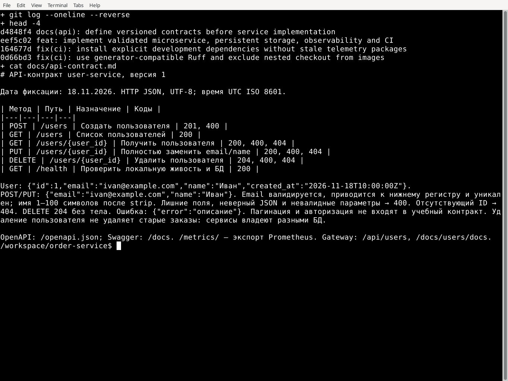

Скриншот 1 — контракт User API и последовательность коммитов.

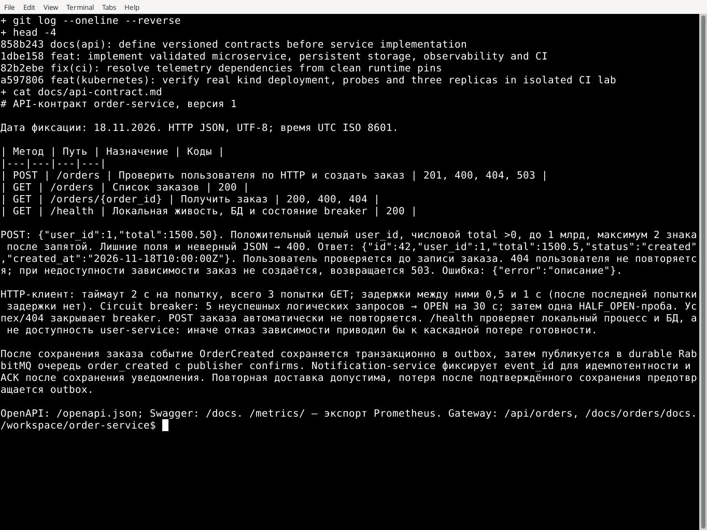

Скриншот 2 — контракт Order API, retry, circuit breaker и событие OrderCreated.

## 2. Запуск контейнеров

Сервисы собраны из отдельных репозиториев. В Compose используются DNS-имена user-service и rabbitmq. /health проверяет локальный процесс и SQLite; сбой user-service не переводит сам order-service в нездоровое состояние.

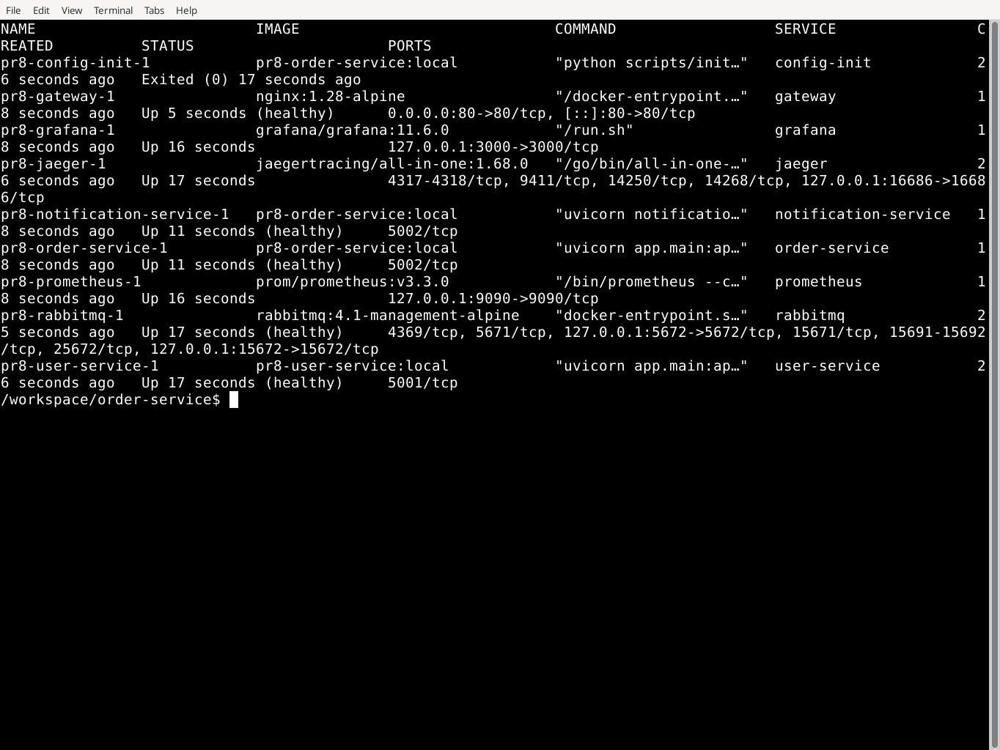

Скриншот 3 — docker compose ps полного стенда: API и очередь healthy, мониторинг запущен.

Nginx принимает клиентские запросы на порту 80. Порты самих API в основном Compose наружу не опубликованы. Для отдельных curl-проверок в рабочей среде использовалось временное отображение портов API на loopback.

## 3. CRUD пользователей

POST /users вернул 201 и назначил ID. GET вернул сохранённую строку, PUT изменил имя с кодом 200. Email валидируется, нормализуется и проверяется на уникальность. DELETE возвращает 204; повторное чтение удалённой записи — 404.

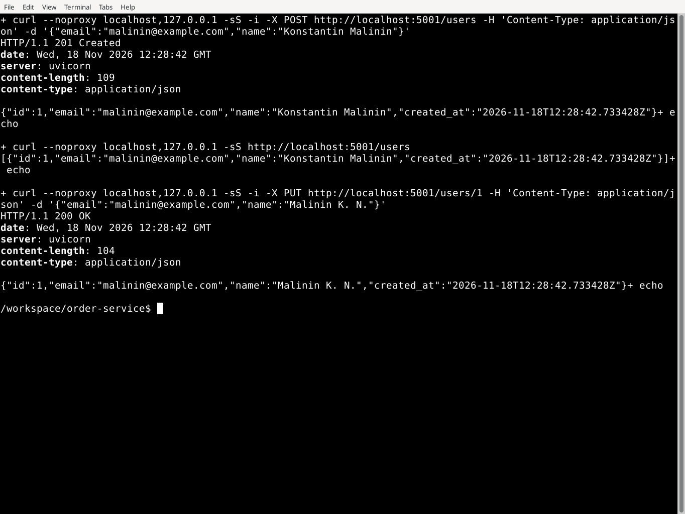

Скриншот 4 — реальные curl-запросы создания, чтения и изменения пользователя.

## 3.1. Удаление пользователя

Для проверки удаления создан отдельный пользователь ID 2. DELETE /users/2 вернул 204 без тела; последующий GET /users/2 — 404. Основной пользователь ID 1 и его заказы сохранены.

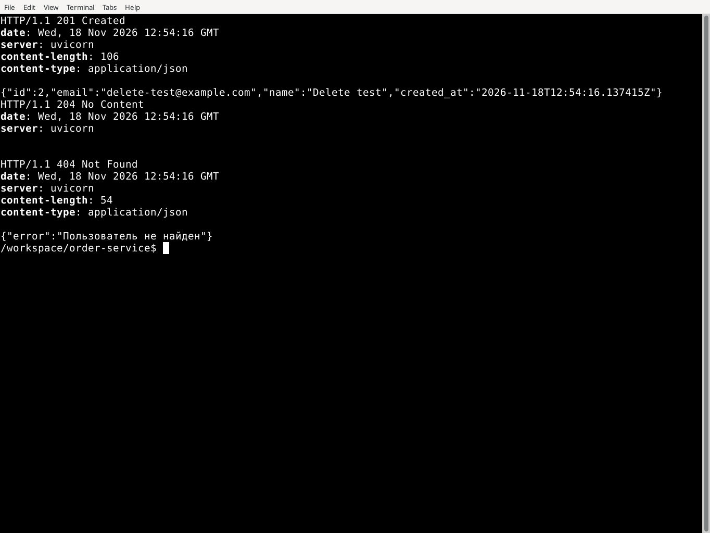

Скриншот 5 — создание тестовой записи, удаление 204 и повторное чтение 404.

## 4. Создание и чтение заказов

Order Service проверил пользователя по HTTP до записи заказа. Создан заказ на 1250,50; GET /orders и GET /orders/{id} возвращают заказы из SQLite. Суммы хранятся в целых копейках, ответ API содержит число.

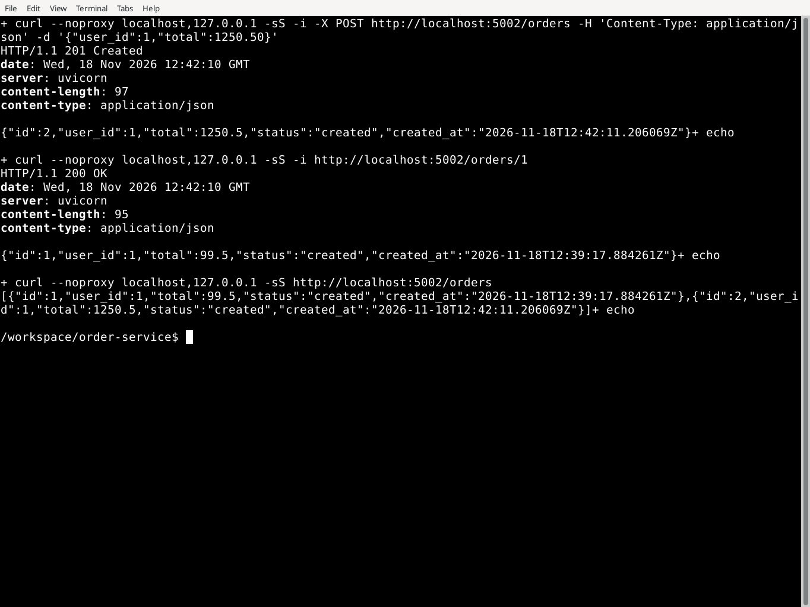

Скриншот 6 — создание и чтение заказов в контейнерном стенде.

## 5. Проверка ошибок

Отрицательная сумма отклоняется с 400. Для несуществующего пользователя и отсутствующего заказа возвращается 404. Некорректное тело запроса не вызывает обращение к User API и не добавляет запись в БД.

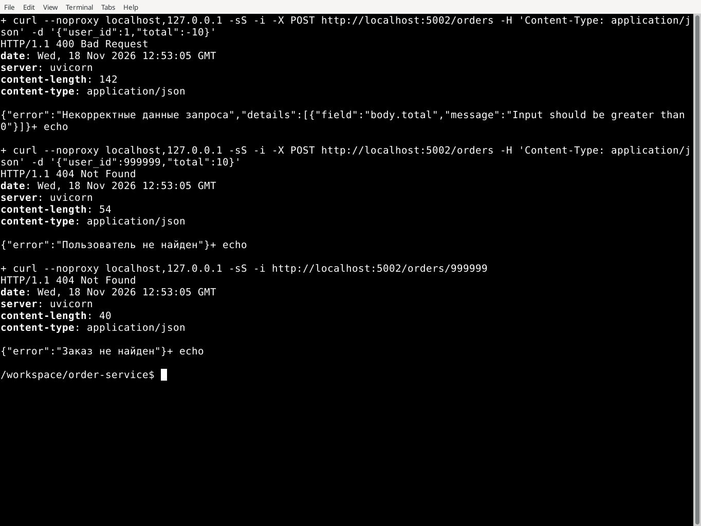

Скриншот 7 — ответы 400 и 404 контейнерного Order API.

Те же сценарии проверяются в тестах и через Nginx в Compose acceptance. Итоговый журнал содержит фактические HTTP-коды и тела ответов.

## 6. Отказ user-service: HTTP 503

Контейнер user-service остановлен. Клиент выполнил три попытки с таймаутом 2 с и паузами 0,5 и 1 с. После последней попытки дополнительной паузы нет. Order API вернул 503 и Retry-After: 30. Неуспешный запрос не создаёт заказ и outbox-событие.

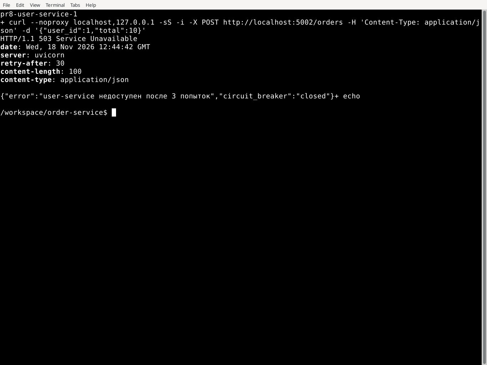

Скриншот 8 — 503 при остановленном контейнере user-service.

## 7. Circuit breaker и восстановление

Порог — пять неуспешных логических обращений к зависимости. После открытия breaker новые запросы отклоняются без повторных HTTP-попыток. Через 30 с допускается одна HALF_OPEN-проба; успешный ответ закрывает breaker.

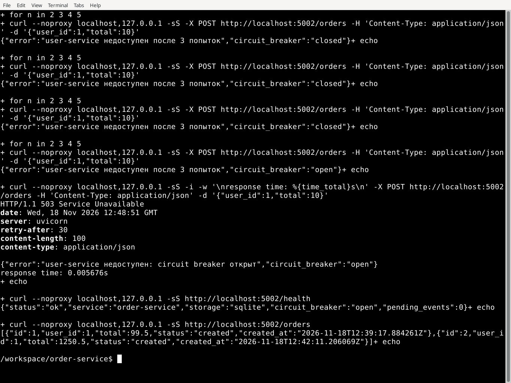

Скриншот 9 — breaker OPEN, быстрый ответ 503 и неизменившийся список заказов.

После запуска user-service новый заказ успешно принят, состояние вернулось в CLOSED. В Compose acceptance дополнительно проверено равенство числа заказов до и после всех запросов 503.

## 8. Тесты User Service

Тесты используют отдельный временный SQLite-файл. Проверяются CRUD, уникальность email, валидация, неизвестные ID, ошибка хранилища, сохранение данных после повторного открытия БД, OpenAPI и метрики. Результат: 21 passed, покрытие 94,65%.

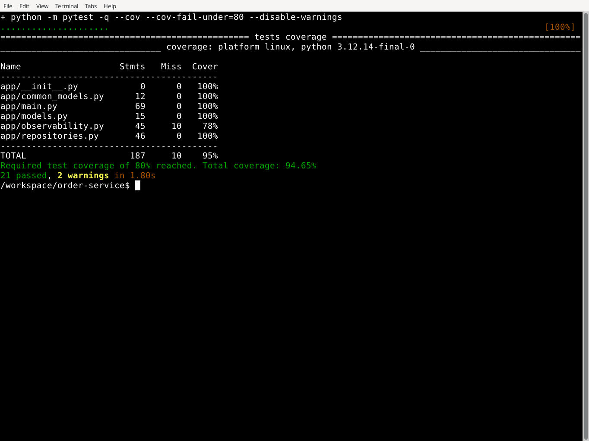

Скриншот 10 — запуск pytest-cov для user-service.

## 9. Тесты Order и Notification

Результат: 45 passed, покрытие 96,72%. Проверены retry/backoff, отсутствие повтора 404, переходы breaker, одновременные HALF_OPEN-запросы, изоляция SQLite, валидация заказа, outbox, подтверждения и повторная доставка уведомлений. Интеграционный тест работает с настоящим RabbitMQ и отдельной очередью.

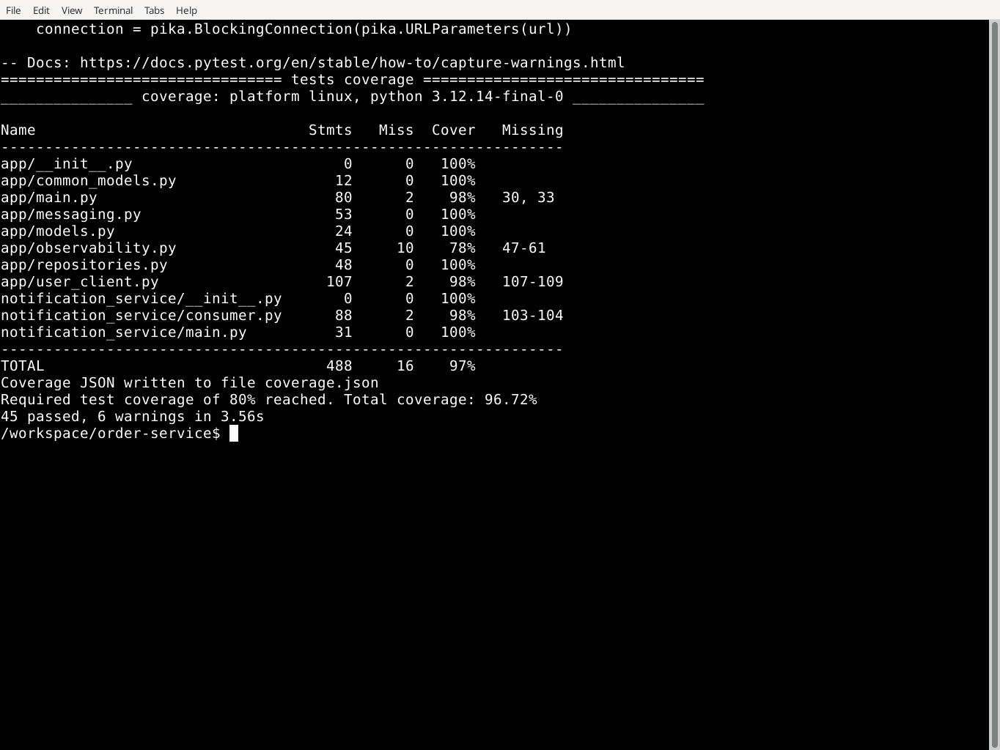

Скриншот 11 — сохранённый журнал реального запуска с TEST_RABBITMQ_URL, без пропущенного брокерного теста.

Покрытие относится к app и notification_service; автоматически сгенерированный клиент не включён в расчёт собственного кода. В CI для обоих сервисов установлен порог 80%.

## A. Постоянное хранение в SQLite

UserRepository и OrderRepository отделяют SQL от HTTP-обработчиков. Применены WAL и параметризованные запросы. Базы пользователей, заказов и уведомлений находятся в трёх разных именованных томах. Тесты не используют рабочие файлы БД.

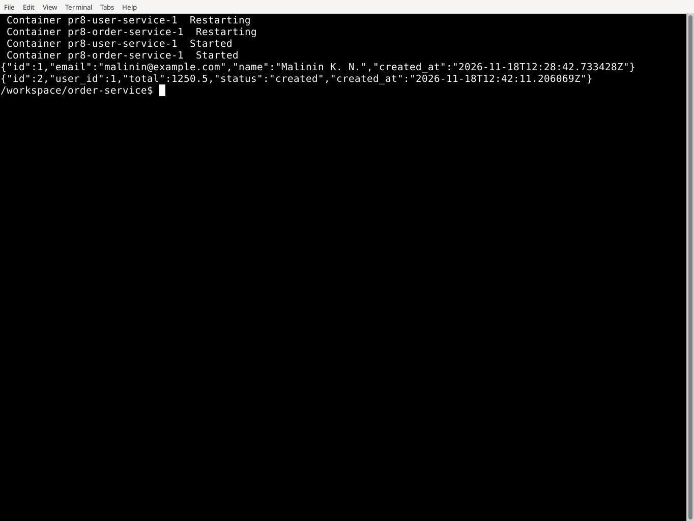

Скриншот 12 — после docker compose restart сохранены пользователь ID 1 и заказ ID 2.

В полном стенде также перезапущен notification-service и проверена сохранность полученного уведомления. Заказ и строка outbox записываются одной транзакцией. Очередь и подтверждения не заменяют постоянное хранилище приложения.

## B. FastAPI, Pydantic и Swagger User

Сервисы реализованы на FastAPI. Модели Pydantic запрещают лишние поля, проверяют email, ID и сумму. Ошибки валидации согласованы с контрактом и возвращают 400. Swagger UI доступен в каждом сервисе по /docs; JS/CSS включены локально.

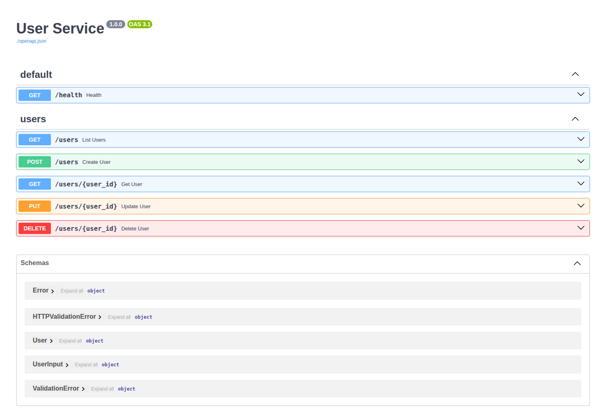

Скриншот 13 — настоящий Swagger UI User Service через gateway.

## B. Swagger Order и generated SDK

SDK создан командой openapi-python-client generate из зафиксированной схемы user-service. Сгенерированный пакет user_contract_client включён в репозиторий и действительно вызывается из UserClient; это не рукописная имитация клиента. Команда воспроизведения: bash scripts/generate_client.sh.

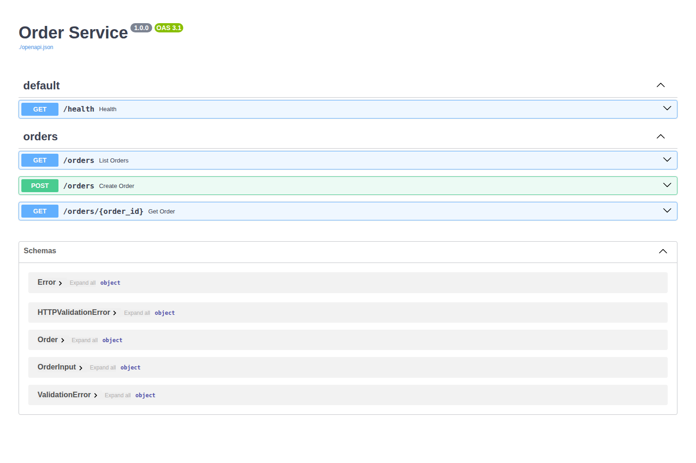

Скриншот 14 — Swagger UI Order Service.

## B. Выполнение запроса в Swagger

В Swagger выполнен GET /orders через Try it out → Execute. Сервер вернул 200 и сохранённые заказы. Документация и рабочая реализация используют одни модели ответов.

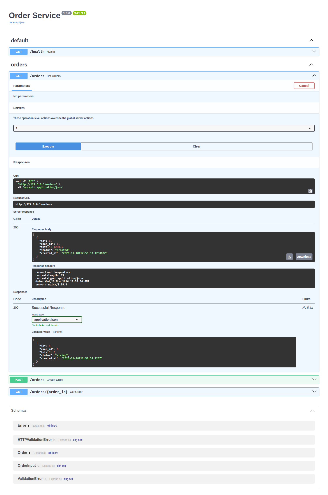

Скриншот 15 — фактический ответ сервера в Swagger UI.

## C. Gateway и ограничение частоты

Nginx слушает порт 80, перенаправляет /api/users и /api/orders в нужные сервисы и удаляет префикс /api. limit_req_zone задаёт 10 запросов/с на IP; без burst избыток немедленно отклоняется с 429. Ниже показана конфигурация из deploy/nginx/nginx.conf.

```text
events { worker_connections 1024; }
http {
  resolver 127.0.0.11 valid=5s ipv6=off;
  limit_req_zone $binary_remote_addr zone=api_limit:10m rate=10r/s;
  limit_req_status 429;
  upstream users { zone users 64k; server user-service:5001 resolve; }
  upstream orders { zone orders 64k; server order-service:5002 resolve; }
  upstream notifications { zone notifications 64k; server notification-service:5003 resolve; }
  server {
    listen 80;
    location = /health { default_type application/json; return 200 '{"status":"ok","service":"gateway"}'; }
    location = /health/users { proxy_pass http://users/health; }
    location = /health/orders { proxy_pass http://orders/health; }
    location = /health/notifications { proxy_pass http://notifications/health; }
    location /api/users { limit_req zone=api_limit; rewrite ^/api(/.*)$ $1 break; proxy_pass http://users; }
    location /api/orders { limit_req zone=api_limit; rewrite ^/api(/.*)$ $1 break; proxy_pass http://orders; }
    location /api/notifications { limit_req zone=api_limit; rewrite ^/api(/.*)$ $1 break; proxy_pass http://notifications; }
    location /docs/users/ { proxy_pass http://users/; }
    location /docs/orders/ { proxy_pass http://orders/; }
    # Swagger Try-it-out uses canonical /users and /orders paths on this same gateway.
    location /users { limit_req zone=api_limit; proxy_pass http://users; }
    location /orders { limit_req zone=api_limit; proxy_pass http://orders; }
  }
}
```

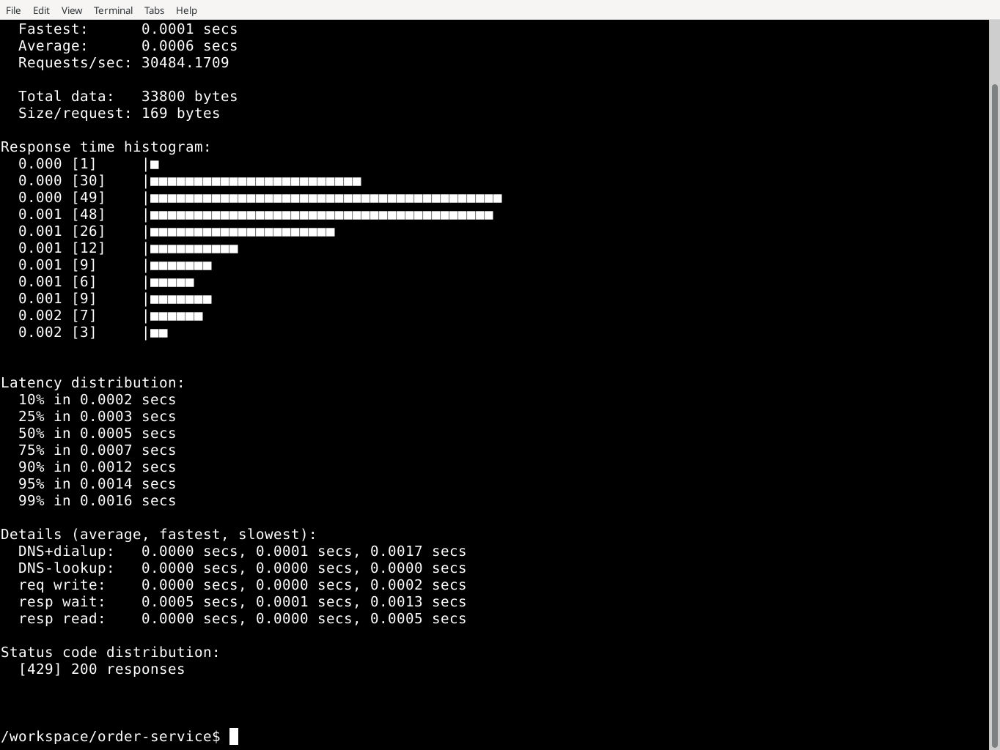

Скриншот 16 — журнал реального превышения лимита, присутствует HTTP 429.

## D. RabbitMQ и отдельный consumer

OrderCreated попадает в durable очередь order_created. OutboxDispatcher использует publisher confirms и persistent сообщения. Notification Service работает отдельным контейнером, пишет факт уведомления в лог и свою SQLite. ACK отправляется после сохранения, event_id предотвращает дубли. Невалидное сообщение отклоняется без бесконечной повторной доставки.

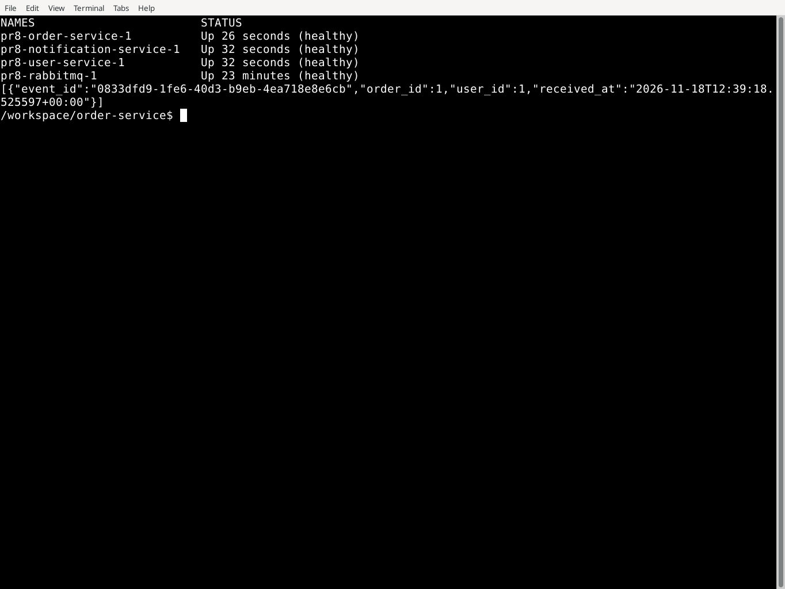

Скриншот 17 — контейнеры healthy и уведомление для созданного заказа.

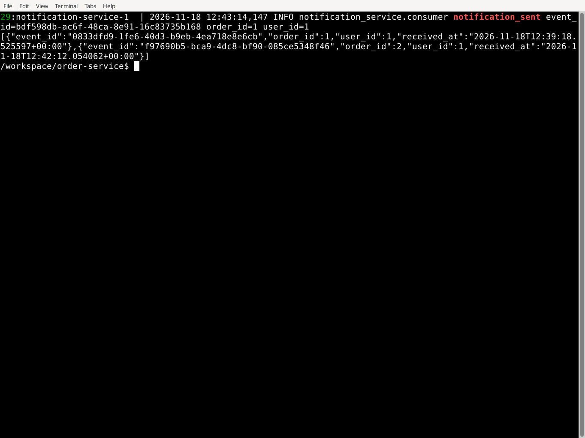

Скриншот 18 — лог фактической обработки OrderCreated из полного Compose-стенда.

Асинхронная обработка уменьшает задержку POST /orders и позволяет временно отключать consumer. При сбое брокера принятый заказ остаётся в БД, а outbox ждёт повторной публикации. Приложение рассчитано на доставку как минимум один раз с идемпотентным consumer.

## E. Prometheus, Grafana и нагрузка

prometheus-flask-exporter подключён через Flask/WSGI-монтирование в FastAPI и общую registry. HTTP middleware учитывает запросы, коды и длительность. Prometheus опрашивает /metrics/ каждые 2 с. Готовый дашборд содержит RPS, latency p95, долю 5xx и circuit_breaker_state.

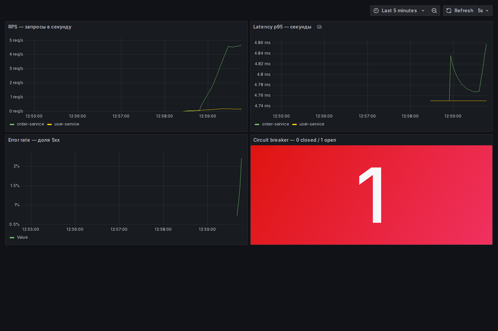

Скриншот 19 — Grafana во время реального отказа зависимости: ошибки и открытый breaker.

## E. Нагрузка и восстановление

Нагрузка создана настоящей утилитой hey: 20 секунд по 5 запросов/с для API; отдельно выполнен всплеск из 200 запросов с 20 параллельными клиентами для проверки limiter. Дополнительно выполнена серия запросов для наполнения временных рядов. Ограничение gateway намеренно даёт 429; эти ответы отделяются от ошибок зависимости 503.

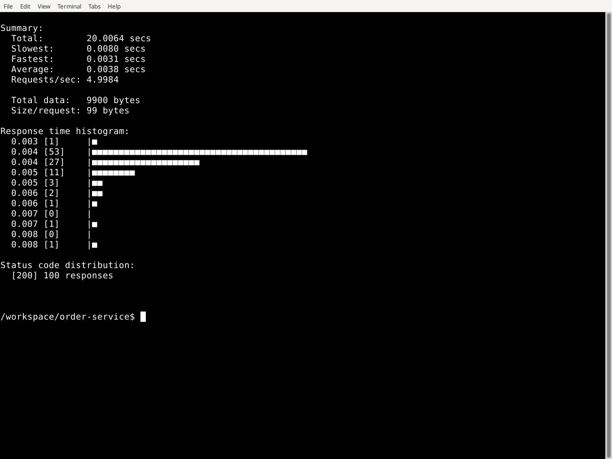

Скриншот 20 — исходный отчёт hey и распределение HTTP-кодов.

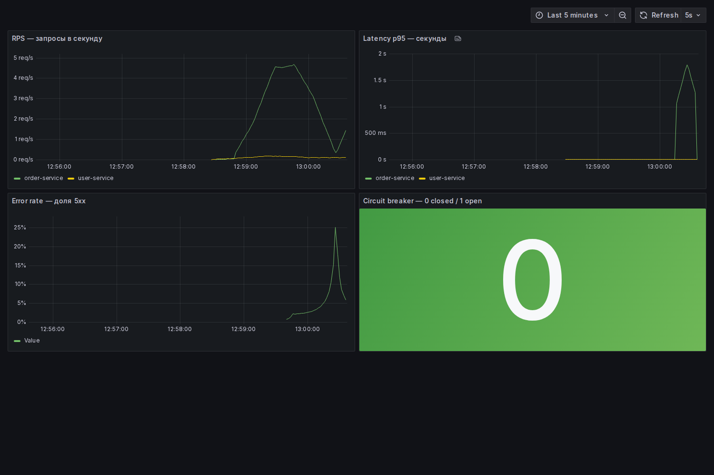

Скриншот 21 — дашборд после восстановления user-service, breaker закрыт.

## F. Распределённая трассировка

В оба API добавлены OpenTelemetry SDK и инструментирование FastAPI. HTTPX-клиент SDK передаёт traceparent. Спаны экспортируются по OTLP HTTP в Jaeger. Из Jaeger API сохранён исходный JSON трейса; у одного traceID присутствуют ресурсы order-service и user-service. Успешный POST /orders (201) связан также с публикацией и обработкой OrderCreated: 12 спанов, 3 сервиса.

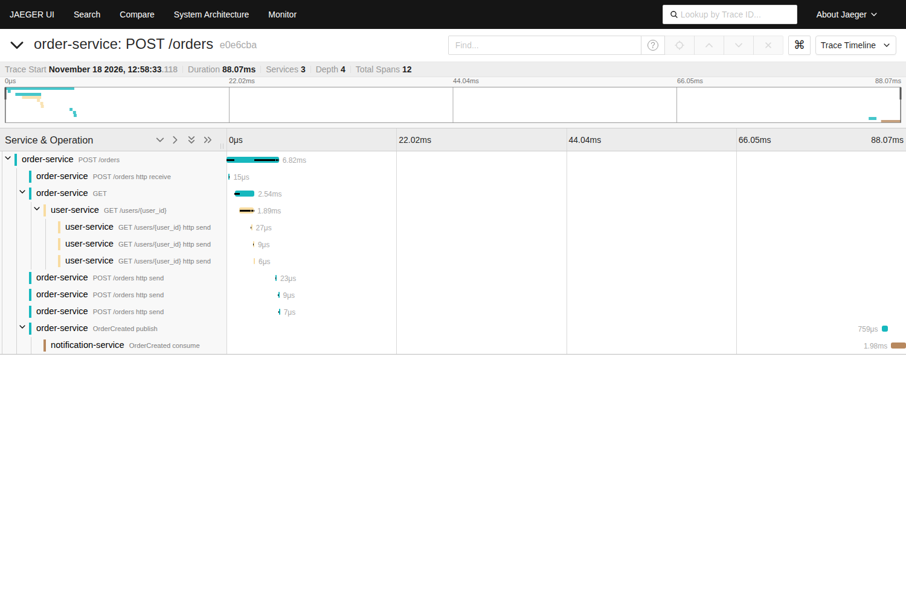

Скриншот 22 — один реальный трейс включает создание заказа и HTTP-вызов User Service.

## G. CI/CD и GitHub Container Registry

В обоих репозиториях есть .github/workflows/ci.yml и бейджи в README. Ruff и pytest выполняются до сборки, падение теста или покрытие ниже 80% блокирует зависимые jobs. В main Docker-образ публикуется в GHCR с тегами latest и SHA. Артефакт image-digest фиксирует точный digest.

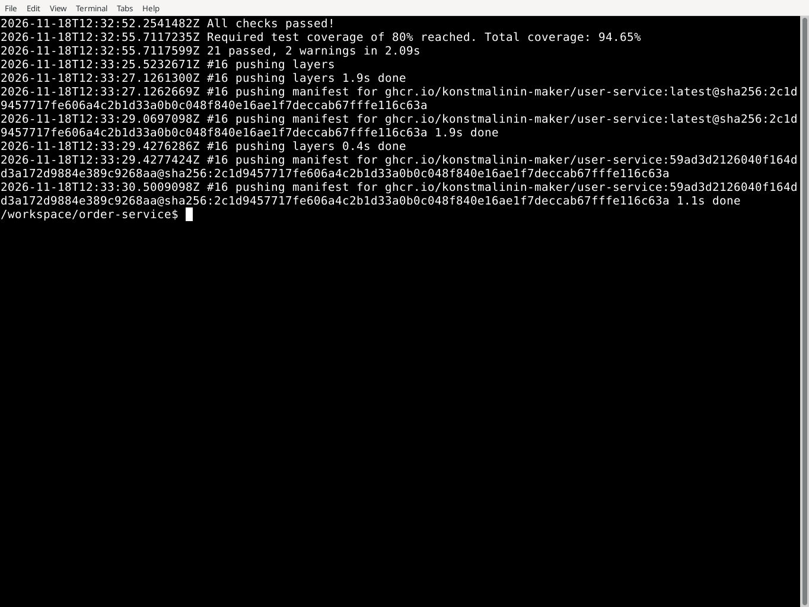

Скриншот 23 — реальный успешный push user-service в GHCR из main.

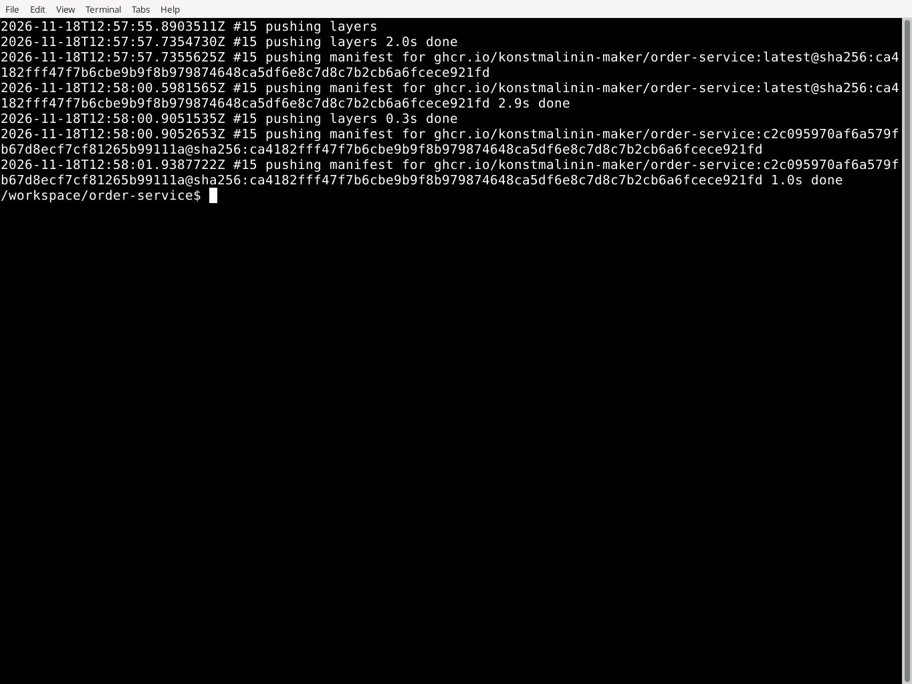

Скриншот 24 — реальный успешный push order-service в GHCR из main.

CI обеспечивает одинаковый повторяемый набор проверок для каждого изменения. Помимо unit-тестов, отдельные jobs создают полный Compose-стенд и настоящий кластер kind; их журналы и PNG прикладываются как артефакты.

## H. Kubernetes: манифесты и масштабирование

Для User, Order, Notification и RabbitMQ созданы Deployment, Service и ConfigMap. SQLite и брокер используют PVC. У API настроены readiness и liveness probes; у consumer readiness зависит от подключения к брокеру, liveness проверяет локальный процесс.

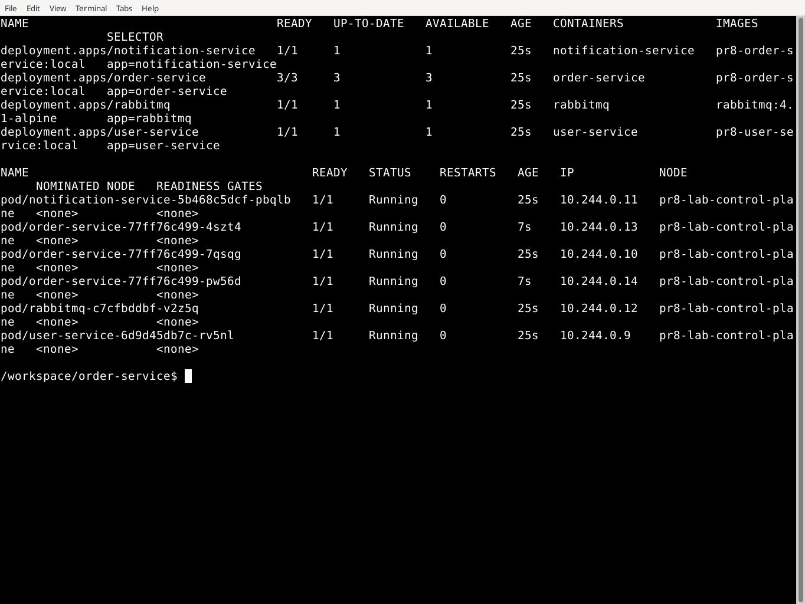

Скриншот 25 — исходный вывод kubectl из реального kind: Order Service 3/3 Ready.

Локальный кластер создан внутри временного Linux runner командой kind create cluster. После kubectl scale order-service --replicas=3 все три pod стали Ready. Это настоящий запуск Kubernetes, а не только YAML-проверка.

## H. Проверка всех трёх реплик

Через HTTP созданы три заказа. Затем kubectl exec выполнил чтение /orders в каждом из трёх pod: все вернули ID 1, 2, 3. Notification Service получил три события. Исходные JSON и полный kind-lab.log сохранены в материалах.

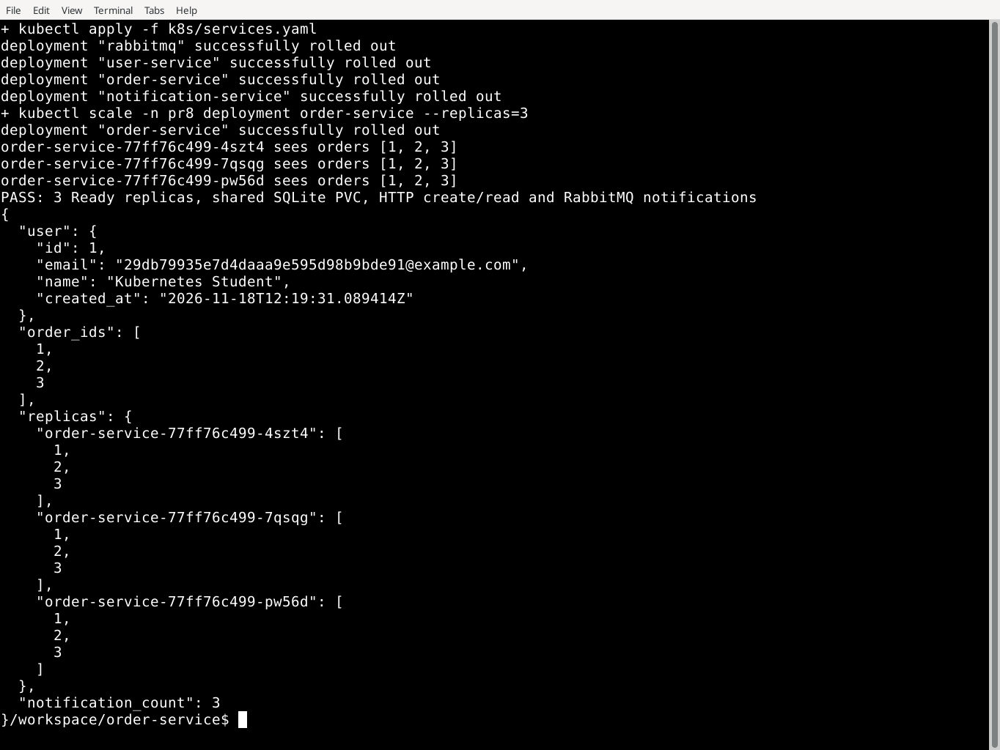

Скриншот 26 — выполнение scale, чтение данных из каждого pod и итоговая проверка.

Учебный кластер одноузловой: SQLite WAL и общий RWO PVC допустимы для нескольких pod на одном узле. Для распределённого production-кластера требуется серверная СУБД, миграции и отдельное решение для конкурентных outbox-dispatcher.

## Контрольные вопросы 1–6

1. Чем микросервис отличается от модуля монолита?
Микросервис — отдельный процесс с сетевым API и независимым развёртыванием. Модуль выполняется в процессе монолита и обычно вызывает другой модуль как функцию. Для микросервиса нужно учитывать сеть, отказ и совместимость контракта.

2. Почему не следует использовать общую БД?
Прямое чтение чужих таблиц связывает схемы, миграции и сроки выпуска. Сервис должен владеть своими данными, а другим предоставлять API или события. В этой работе users.sqlite3 и orders.sqlite3 раздельны; наличие пользователя проверяется по HTTP.

3. Зачем согласовывать контракт до реализации?
Контракт задаёт методы, пути, типы и коды ошибок. Реализации можно разрабатывать независимо и заранее генерировать клиент. В истории обоих репозиториев контракт предшествует коду; изменения схемы требуют проверки совместимости.

4. Что будет без HTTP-таймаута?
Недоступная зависимость может надолго занять поток и соединение. Очередь запросов растёт, клиент ждёт и каскадный отказ распространяется дальше. Ограниченный таймаут позволяет вернуть 503 и освободить ресурсы.

5. Чем Retry отличается от Circuit Breaker?
Retry повторяет отдельную безопасную операцию при кратком сбое. Circuit breaker прекращает новые попытки, когда накопилось достаточно неудач. В работе три попытки относятся к одному логическому обращению, а порог пяти обращений открывает breaker.

6. Зачем exponential backoff?
Увеличивающиеся паузы уменьшают давление на восстанавливающуюся зависимость. Здесь это 0,5 и 1 с между тремя GET-попытками. В более крупной системе нужен jitter, чтобы клиенты не повторяли запросы одновременно.

## Контрольные вопросы 7–12

7. Как сервисы находят друг друга в Compose?
Compose создаёт сеть и DNS-записи по именам сервисов. Внутри order-service адрес пользователя — http://user-service:5001. При пересоздании контейнера IP может измениться, имя остаётся стабильным.

8. Чем localhost отличается от имени сервиса?
В контейнере localhost обозначает этот же контейнер, а не соседний и не хост. Поэтому order-service использует имя user-service. Loopback-адрес применяется для healthcheck самого контейнера и для опубликованных портов со стороны хоста.

9. Почему 503, а не 500?
503 указывает на временную недоступность возможности обслужить запрос из-за зависимости. 500 означает необработанную внутреннюю ошибку. Клиент может отличить отказ зависимости от дефекта сервера, но не должен вслепую повторять неидемпотентный POST.

10. Как тестировать недоступную зависимость?
Unit-тесты управляют HTTP transport, часами и sleep и проверяют число попыток, backoff и состояния breaker. Интеграционная проверка останавливает настоящий user-service, получает 503, сравнивает число заказов и проверяет восстановление после запуска.

11. Что даёт асинхронный подход?
Создание заказа не ждёт отправки уведомления. Consumer можно восстанавливать и масштабировать отдельно. Цена — eventual consistency, повторная доставка и необходимость идемпотентности. Outbox и ACK после записи уменьшают риск потери сообщения.

12. Что усложнится при 20 сервисах?
Появятся версии контрактов, service discovery, управление конфигурацией и секретами, миграции, сетевые политики, балансировка и лимиты. Для поиска проблем нужны централизованные логи, метрики и распределённые трейсы; для выпуска — автоматизированный CI/CD.

## Трудности, решения и результат

1. Создание репозиториев через GitHub-подключение было недоступно. После создания пустых репозиториев владельцем опубликованы контракты, реализации и CI. Изменения проходили через отдельные ветки и pull request.

2. Рабочая среда использует Docker VFS и ограниченный диск: полный набор Grafana, Prometheus, Jaeger и RabbitMQ не помещался одновременно. Полный Compose и kind выполнены на временных runner, а контейнерное ядро отдельно проверено в рабочей среде. В отчёте место выполнения указано явно.

3. Для rootless kind в рабочей среде не было делегирования cgroup. На Linux runner создан настоящий локальный кластер kind, выполнены rollout, probes, scale и HTTP-проверка каждой реплики.

4. При инициализации томов Nginx обнаружена ссылка modules, ведущая за пределы контейнера config-init. Инициализатор сохраняет ссылки и меняет права только обычных файлов и каталогов. Gateway healthcheck обращается к IPv4 127.0.0.1, который слушает Nginx.

5. Прокси рабочей среды мешал внутренним HTTP-вызовам. В Compose заданы NO_PROXY и no_proxy для имён сервисов и loopback. Внешние соединения не затрагиваются. Для live-дашборда ожидание networkidle заменено ожиданием отрисованных панелей.

| Часть | Подтверждение |
| --- | --- |
| Основная | Контракты, healthy, curl CRUD, 400/404/503, breaker, тесты |
| A / B | restart SQLite; Swagger и реально используемый generated SDK |
| C / D | Nginx 10 r/s и 429; очередь, consumer, настоящий брокерный тест |
| E / F | hey и Grafana; JSON и скриншот общего трейса в Jaeger |
| G / H | Успешный GHCR push обоих сервисов; kind, probes, 3 Ready реплики |

В результате получены два независимых REST-сервиса и отдельный consumer. Сбой User API обрабатывается до записи заказа; данные переживают перезапуск, события доставляются через очередь, поведение наблюдается в метриках и трейсах. Все дополнительные задания A–H выполнены.
